<!--
  Every image on this page is generated by scripts/build.py (see scripts/content.py to edit the text).
  The activity monitor is rebuilt by .github/workflows/profile-stats.yml and served from the `output` branch.
-->

  <picture>
    <source media="(prefers-color-scheme: dark)" srcset="assets/hero-dark.svg">
    <source media="(prefers-color-scheme: light)" srcset="assets/hero-light.svg">
    
  </picture>

  <a href="https://www.linkedin.com/in/mohamed-sayed-abdulrazek/">
    <picture>
      <source media="(prefers-color-scheme: dark)" srcset="assets/btn-linkedin-dark.svg">
      <source media="(prefers-color-scheme: light)" srcset="assets/btn-linkedin-light.svg">
      
    </picture>
  </a>
  <a href="mailto:m.s.abdulrazek@gmail.com">
    <picture>
      <source media="(prefers-color-scheme: dark)" srcset="assets/btn-email-dark.svg">
      <source media="(prefers-color-scheme: light)" srcset="assets/btn-email-light.svg">
      
    </picture>
  </a>
  <a href="https://mosayed.me">
    <picture>
      <source media="(prefers-color-scheme: dark)" srcset="assets/btn-portfolio-dark.svg">
      <source media="(prefers-color-scheme: light)" srcset="assets/btn-portfolio-light.svg">
      
    </picture>
  </a>

 

  <picture>
    <source media="(prefers-color-scheme: dark)" srcset="assets/terminal-dark.svg">
    <source media="(prefers-color-scheme: light)" srcset="assets/terminal-light.svg">
    
  </picture>

  <picture>
    <source media="(prefers-color-scheme: dark)" srcset="assets/stack-dark.svg">
    <source media="(prefers-color-scheme: light)" srcset="assets/stack-light.svg">
    
  </picture>

  <picture>
    <source media="(prefers-color-scheme: dark)" srcset="https://raw.githubusercontent.com/MohamedSayedAbdelrazek/MohamedSayedAbdelrazek/output/stats-dark.svg">
    <source media="(prefers-color-scheme: light)" srcset="https://raw.githubusercontent.com/MohamedSayedAbdelrazek/MohamedSayedAbdelrazek/output/stats-light.svg">
    
  </picture>

 

  <em>“Debugging is like being the detective in a crime movie where you are also the murderer.”</em>
   
  — Filipe Fortes

 

  <picture>
    <source media="(prefers-color-scheme: dark)" srcset="assets/footer-dark.svg">
    <source media="(prefers-color-scheme: light)" srcset="assets/footer-light.svg">
    
  </picture>

  
   
  Every card above is a hand-built animated SVG rendered by <a href="scripts/build.py">my own Python pipeline</a> · the activity monitor refreshes itself with GitHub Actions.

